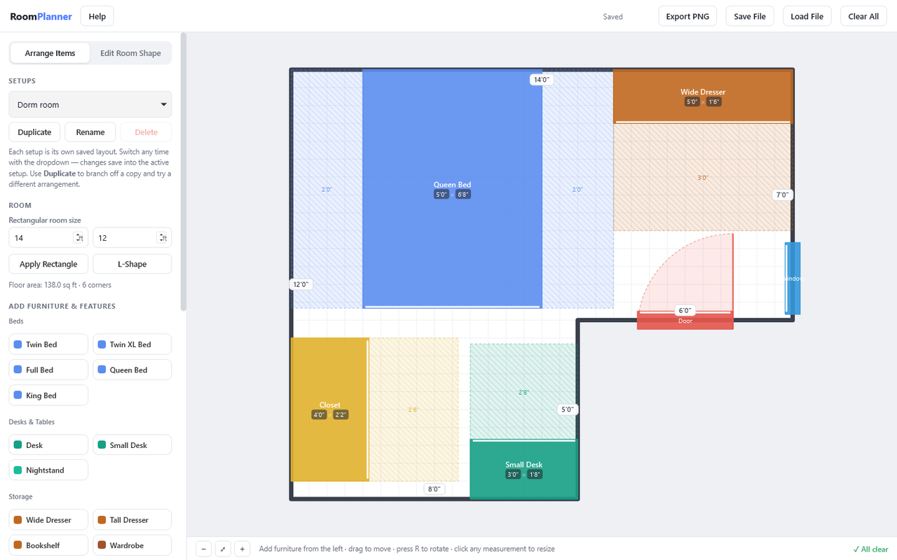
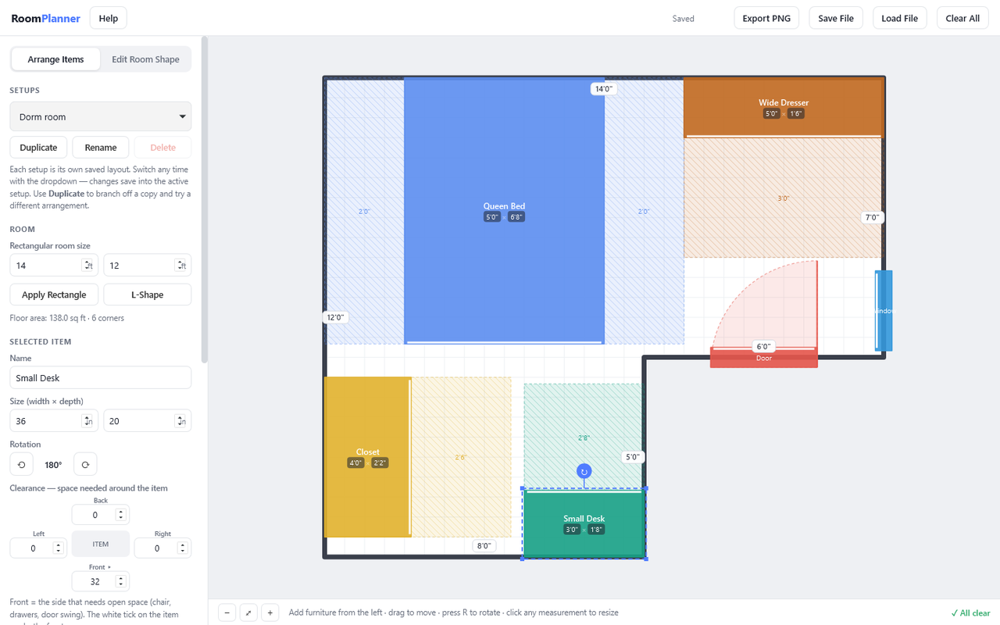

# Room Planner

A to-scale bedroom layout planner: draw the room (L-shapes and alcoves too), drag furniture around, and it tells you if anything doesn't fit or blocks a drawer, chair or door.

**[▶ Open the live app](https://timothyhadfield.github.io/room-setup/)** · best on a laptop (drag with a mouse, keyboard shortcuts)

  

  

## Features
- **Any room shape** — set a rectangle, start from an L-shape, then drag corners and double-click walls to add corners for closets and alcoves.
- **Exact measurements** — click any wall length or furniture size on the plan and type the number. Walls you set lock 🔒 so later edits don't move them.
- **Furniture library** — beds (twin to king), desks, nightstands, dressers, bookshelf, wardrobe, chairs, TV stand, rugs, plus doors, closets, windows and custom items.
- **Clearance zones** — each item carries the space it needs (desk chair, open drawers, door swing), shown as striped zones you can adjust.
- **Layout check** — flags anything that overlaps, sticks through a wall, or blocks another item's clearance.
- **Snapping, rotating, undo** — snaps to grid, walls and other furniture; R rotates, Ctrl+D duplicates, Ctrl+Z / Ctrl+Y undo and redo.
- **Save your ideas** — several named setups saved in the browser, JSON save/load, and PNG export. Units in inches, feet & inches, or centimeters.

## Built with
One HTML file with vanilla JavaScript and HTML canvas. No libraries.
